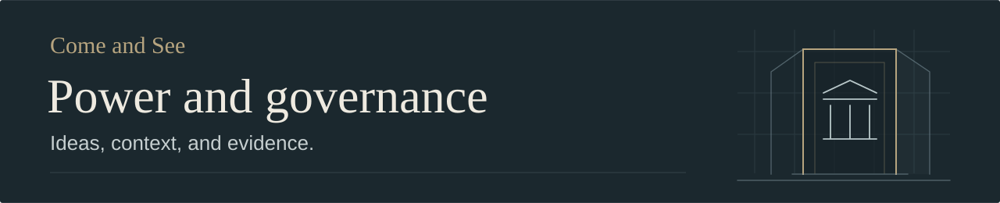

# Power and governance

How political authority, institutions, money, information, and belief interact.
This collection includes documented history and attributed theories about less
visible forms of influence. Evidence categories and editorial status distinguish
their different kinds of claims.

- [Secret societies, finance, and political power](secret-societies-finance-and-political-power.md)
  — a draft examination of financial networks, institutions, religious purpose,
  and competing accounts of political leadership, with focused contextual checks.
- [Deep State: original note](Deep%20state.md) — legacy material with unverified
  authorship and sourcing; preserved for further investigation.

**October 25, 2026:** Renamed from `DEEP STATE` to accommodate institutional,
financial, and religious explanations without declaring a single explanation
established. The original note's body is preserved.

[Back to the collection](../README.md)
