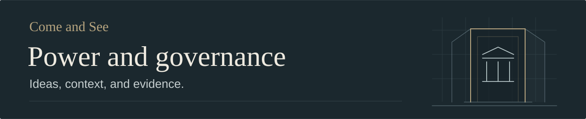

# Secret societies, finance, and political power

*Money, information, institutions, and belief as competing explanations of influence.*

| | Article details |
| :--- | :--- |
| **Status** | Draft — several historical, organizational, and causal claims remain unverified. |
| **Main categories** | Interpretations drawn from evidence; Hypotheses and disputed claims. |
| **Other claim types** | Documented records, religious and political positions, and open questions. |
| **First researched** | October 25, 2026 |
| **Revised** | October 31, 2026 |

## In brief

Political power can be examined through resources, access to decisions, lasting
institutions, and commitments that coordinate people. The central question is
how these advantages translate into particular decisions, and how much control
they actually confer.

Jiang Xueqin argues that privileged information, placement inside governments,
and coordination make secret networks competitive in international finance.
Some networks, in his account, pursue end-times religious goals and try to
accelerate history. His most speculative model gives occultists a vision,
financiers the resources, and politicians its implementation. He proposes a
concealed religious-financial recruitment chain behind Epstein's elite access,
linking Sabbatean and Frankist history to Chabad and contemporary figures. He
limits this to subsets of these worlds and expressly concedes that the
connecting narrative lacks evidence.
[Financial mechanism](https://www.youtube.com/watch?v=reKR1VozUFI&t=263s) ·
[Religious motive](https://www.youtube.com/watch?v=reKR1VozUFI&t=513s) ·
[Model and qualification](https://www.youtube.com/watch?v=lPze7AA7gAA&t=3024s).

His further allegation places Epstein above Mossad, making the proposed network
superior to a state intelligence agency.
[Hidden-hierarchy claim](https://www.youtube.com/watch?v=reKR1VozUFI&t=491s).

Competing explanations give states and individual leaders more agency. Nick
Fuentes rejects Illuminati-style control in favor of states and rival factions,
yet advances an unverified allegation of collective Jewish disloyalty. Jiang
links blocked opportunity amid abundance to entrenched older elites; Fuentes
distinguishes those elites from ordinary retirees. Each advocates dictatorship
as a remedy. Jiang speculates that a war emergency could suspend constitutional
limits and enable a third Trump term; Fuentes doubts Trump's governing capacity
and ability to secure one. These are political positions and
forecasts.
[Competing power models](https://www.youtube.com/watch?v=2mXVgspSfvo&t=487s) ·
[Political prescriptions](https://www.youtube.com/watch?v=2mXVgspSfvo&t=2007s).

The institutional context matters: the Federal Reserve's Board is a federal
agency, and the Bank of England is government-owned. Those structures require
more precision than a claim that money is simply privately controlled. The
Twenty-second Amendment bars election to the US presidency more than twice;
a prediction of an extra term does not establish a lawful route to it.
[Federal Reserve](https://www.federalreserve.gov/faqs/about_14986.htm) ·
[Bank of England](https://www.bankofengland.co.uk/explainers/who-owns-the-bank-of-england) ·
[Constitutional text](https://www.archives.gov/founding-docs/amendments-11-27).

The distinction to remember is between an advantage, a coordinated action, and
control of an outcome. Explanations of decline also need to distinguish intent
from institutional incentives. For individual leaders, campaign skill, legal
authority, and governing capacity are separate questions.

## Finance and information

**Proposed mechanisms and historical interpretation.** International finance
raises several different questions:

| Resource | Possible route to influence | Records that would clarify a particular case |
| :--- | :--- | :--- |
| Capital | Finance an activity, attach conditions, or withdraw support | Contracts, ownership, funding flows, and timing |
| Information | Act before competitors or influence their expectations | Communications, access records, transactions, and publication times |
| Institutional access | Shape appointments, advice, or policy implementation | Formal powers, briefings, appointments, and decisions |
| Coordination | Align actions that would otherwise be separate | Instructions, agreements, meetings, and observable joint conduct |

Jiang's Waterloo example combines early news, market panic, and bond trading;
he does not identify who originated the false rumor. It illustrates the proposed
value of knowing more than other traders, while the historical size and means
of the gain require separate checking.
[Information advantage](https://www.youtube.com/watch?v=reKR1VozUFI&t=290s).

Jiang calls the Federal Reserve privately controlled, tracing financial power
back to the Bank of England.
[Monetary origins claim](https://www.youtube.com/watch?v=2mXVgspSfvo&t=57s).
The distinction between a central bank's legal ownership, policy independence,
and access by commercial banks is therefore consequential. The institutional
checks below address these separately.

An information network can be effective without controlling governments. An
investor can influence a decision without writing every rule. Neither outcome
requires treating the entire financial system as one actor.

## Institutions, factions, and personal agency

**Competing interpretations.** Fuentes assigns secrecy to intelligence agencies
and coercive power to states.
[States and factions](https://www.youtube.com/watch?v=2mXVgspSfvo&t=540s).
The collection's [original Deep State note](Deep%20state.md) instead emphasizes
permanent administrative and intelligence organizations that outlast elected
leaders. Its provenance and several factual assertions remain unresolved.

These explanations imply different ways to investigate a policy. Formal
authority concerns who can issue an order. Institutional influence concerns who
filters information or implements it. Personal agency concerns who chooses,
including the choice to appoint advisers or ignore advice. External financing
is another possible influence. These mechanisms can coexist, compete, or fail;
they should not be assumed to form one command structure.

Claims of a group loyalty also need a defined actor. Fuentes's population-wide
allegation does not establish an organization, common instructions, or a
particular act. Jewish identity, religious affiliation, or a prominent person's
surname cannot supply those missing links. The same standard applies to
accusations involving Freemasons, Jesuits, Chabad, or any other community.

## Belief, coordination, and the hidden-hierarchy hypothesis

**Religious positions and unverified causal claims.** In Jiang's religious
explanation, faith can outrank profit: end-times commitments supposedly mobilize
mass support and make war, revolution, and religion vehicles for accelerating a
divine plan.
[Faith and acceleration](https://www.youtube.com/watch?v=reKR1VozUFI&t=536s).

The proposed lineage runs through Sabbatai Zevi, Jacob Frank, and Menachem
Mendel Schneerson. Jiang treats inherited loyalties and elite recruitment as
bridges between religious history and present power, then imagines roles for
Wexner, Trump, and Kushner. These connections are his reconstruction, including
a thought experiment, rather than a documented sequence.
[Lineage hypothesis](https://www.youtube.com/watch?v=lPze7AA7gAA&t=1880s) ·
[Undocumented bridge](https://www.youtube.com/watch?v=lPze7AA7gAA&t=2483s) ·
[Recruitment scenario](https://www.youtube.com/watch?v=lPze7AA7gAA&t=2651s).

Fuentes challenges Rothschild–Frankist affiliation; Jiang cannot supply evidence
offhand and acknowledges uncertainty about current secret societies.
[Disputed affiliation](https://www.youtube.com/watch?v=2mXVgspSfvo&t=701s) ·
[Uncertainty about current groups](https://www.youtube.com/watch?v=2mXVgspSfvo&t=824s).

A shared belief could help explain persistence, sacrifice, or coordination. It
would still be necessary to show who held that belief, what they did because
of it, and how their conduct affected an outcome. Shared symbols and social
contacts can suggest questions; a historical lineage and an operational chain
of command each need their own evidence.

## Decline, status, and blocked renewal

**An analogy and a dispute about responsibility.** Jiang's rodent-colony analogy
concerns blocked status; Fuentes distinguishes elites from ordinary retirees.
[Status and succession](https://www.youtube.com/watch?v=2mXVgspSfvo&t=1347s) ·
[Generational objection](https://www.youtube.com/watch?v=2mXVgspSfvo&t=1560s).

This raises a question distinct from deliberate coordination: could institutions
produce stagnation through incentives and blocked succession? To examine that
possibility, separate a birth cohort from officeholders, asset owners, and
specific gatekeepers. An age distribution, a concentration of wealth, and a
rule that blocks entry would be different observations. An animal experiment
can suggest a hypothesis without establishing an account of human society.

## Political prescriptions and the problem of executive power

**Normative positions and forecasts.** Fuentes sees voting as insufficient;
Jiang wants to break polarization and oligarchic extraction.
[Authoritarian prescription](https://www.youtube.com/watch?v=2mXVgspSfvo&t=2007s).

A diagnosis of concentrated power does not by itself establish that concentrating
more power will repair it. That proposal raises its own institutional questions:
what would constrain the new ruler, how could errors be corrected, and how would
succession work? Campaigning effectively, holding legal authority, securing
obedience, and administering a government are distinct capacities.

A third-term forecast also differs from constitutional authority. Speculation
about a war emergency suspending constitutional limits does not establish an
exception to the election limit. The relevant constitutional text is included
below; this article does not establish a succession workaround.

## Focused context and evidence

Read the institutional, legal, and historical checks

These checks address the central mechanisms and examples. They are not a
complete history of finance, religion, or intelligence organizations.

### Central banks: ownership and policy authority

The [Federal Reserve's institutional description](https://www.federalreserve.gov/faqs/about_14986.htm)
identifies the Board of Governors as a federal agency. The system also includes
12 regional Reserve Banks; the stock held by commercial member banks differs
from ordinary corporate ownership. These distinctions do not support reducing
the entire arrangement to an ordinary private banking company.

The [Bank of England's ownership history](https://www.bankofengland.co.uk/explainers/who-owns-the-bank-of-england)
records its founding with private shareholders in 1694 and nationalization in
1946. Today it is owned by the UK government. Operational independence over
monetary policy and legal ownership are separate questions.

These official accounts describe formal structures. Investigating informal
influence still requires evidence about specific actions and decisions.

### Presidential terms and the difference between prediction and law

The [Twenty-second Amendment](https://www.archives.gov/founding-docs/amendments-11-27)
prohibits election to the presidency more than twice. Speculation about power,
crisis, or future conduct does not establish constitutional authorization.
Possible succession scenarios involve additional constitutional questions and
are not resolved here.

### A documented warning about institutional influence

Eisenhower's farewell address was delivered on January 17, 1961. His warning
concerned excessive influence arising from the conjunction of military
institutions and the arms industry.
[National Archives transcript](https://www.archives.gov/milestone-documents/president-dwight-d-eisenhowers-farewell-address).
The original Deep State note gives the wrong year and substitutes a stronger
CIA-centered formulation that is not the wording of this address.

### Information advantage and Waterloo

The Rothschild Archive describes a communications network and cites a
contemporary letter suggesting Nathan benefited from early news. Its
[account of the Waterloo commission](https://www.rothschildarchive.org/business/n_m_rothschild_and_sons_london/nathan_mayer_rothschild_and_the_waterloo_commission)
also says evidence for a huge trading windfall is slender and the gain cannot
be reliably calculated from surviving records. It supports a narrower
information-network account than a demonstrated market-deception scheme. The
archive's family-related institutional perspective remains relevant to how its
account is assessed.

### Epstein: a prosecution record and a separate hierarchy allegation

A [July 8, 2019 federal announcement](https://www.justice.gov/usao-sdny/pr/jeffrey-epstein-charged-manhattan-federal-court-sex-trafficking-minors)
records Epstein's arrest and charges for sex trafficking of minors and
conspiracy to commit sex trafficking. It describes prosecution allegations;
a charge differs from a finding of guilt. It does not verify an occult chain
of command or an intelligence hierarchy. A claim supposedly established by
released files needs an identifiable document and passage, with provenance.

### Religious continuity and coordinated action

The proposed historical affiliations, hereditary loyalties, and recruitment
chain remain unverified. A movement's existence does not authenticate a later
organization's alleged descent from it. Criminal and ritual-abuse allegations
require specific evidence; neither ancestry nor religious membership establishes
conduct. An unresolved historical link and an untestable theological belief
also call for different assessments.

## Open questions

- Which identifiable people, organizations, and decisions would make each model
  concrete enough to investigate?
- Which records show an information advantage, a financial interest, an
  instruction, or a causal contribution to policy?
- Where does coordination end and competition between factions begin?
- How could financial incentives, religious commitments, institutional inertia,
  and personal ambition be distinguished in the same case?
- What would change confidence in a claimed lineage or hidden hierarchy?
- Which account explains failures and unintended consequences as well as apparent
  successes?
- How would the proposed political remedy avoid reproducing the concentration
  of power it is meant to challenge?

## Source register and coverage

The recordings are sources for their participants' arguments. They do not by
themselves verify historical claims, collective loyalties, or hidden control.
Repeated presentations by Jiang are not independent corroboration. Host questions,
speaker assertions, and the repository's analytical connections have different
roles.

| Resource | Publication and coverage |
| :--- | :--- |
| [Truth About Jeffery Epstein, Rothschild & Secret Societies](https://www.youtube.com/watch?v=lPze7AA7gAA), Raj Shamani Clips; Jiang Xueqin | August 11, 2026; 52:31. Excerpt from *Figuring Out* episode 547; [parent episode](https://www.figuringout.co/link/fo-547). Captioned discussion runs to about 52:07 before an outro. |
| [Do Secret Societies Actually Rule the World?](https://www.youtube.com/watch?v=reKR1VozUFI), Theo Von Clips; Jiang Xueqin | August 18, 2026; 12:20. Excerpt from *This Past Weekend* #675; [parent episode](https://www.youtube.com/watch?v=3cZN0OcSsqE). Last available caption segment starts at about 12:01. |
| [Nick Fuentes vs Professor Jiang: Who Actually Runs the World](https://www.youtube.com/watch?v=2mXVgspSfvo), Jack Neel; Jiang Xueqin and Nick Fuentes | September 29, 2026; 52:50. Available captions extend through the ending at about 52:48. |
| [Deep State](Deep%20state.md), collection note | Original authorship, date, and source are unknown. Its body is preserved as legacy material awaiting verification. |

Coverage uses English auto-generated captions, descriptions, and metadata; no
manual audio or visual verification has been completed. The supplied excerpts
were read through their available captions. The linked parent episodes were not
reviewed. Publication dates do not establish recording dates. Captioned names,
quotations, current-event anecdotes, and displayed material may need correction.
The Jack Neel excerpt ends during discussion; its ending does not establish a
consensus. Raw transcripts remain outside the repository.

**Additional navigation:**
[Challenge to the initial narrative](https://www.youtube.com/watch?v=lPze7AA7gAA&t=629s) ·
[Demand for lineage evidence](https://www.youtube.com/watch?v=2mXVgspSfvo&t=701s) ·
[Trump and a possible third term](https://www.youtube.com/watch?v=2mXVgspSfvo&t=2363s) ·
[Explanatory limits](https://www.youtube.com/watch?v=lPze7AA7gAA&t=3041s).

## Revision record

**2026-10-25:** Initial synthesis from the two Jiang clips, with focused contextual
research. The former `DEEP STATE` folder became `POWER & GOVERNANCE`; the original
note's body was preserved and its unknown provenance made explicit. Separate
readers checked the two summaries against their captions.

**2026-10-31:** Reorganized around concepts and mechanisms, integrated the Jack
Neel debate's disagreements and political prescriptions, and moved the resource
register below the article. Added institutional and constitutional context.
Historical affiliations, recruitment and hierarchy allegations, current-event
premises, caption accuracy, and uncaptained material remain unresolved. The
expanded draft awaits separate source-fidelity and evidence review.

[Power and governance index](README.md) · [Back to the collection](../README.md)
