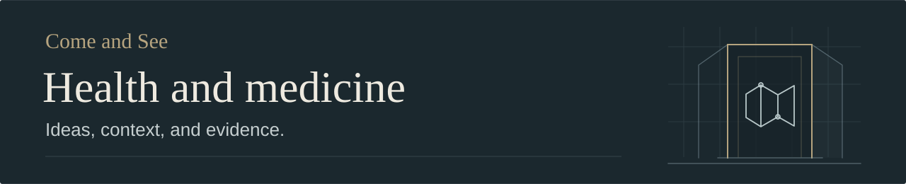

# Baking soda and cancer cells

The [section on tumor acidity and bicarbonate](../README.md#what-acidity-changes-around-a-tumor) covers the original claims, the animal and human studies, and the risks of taking baking soda. The previous note is preserved in Git history.
