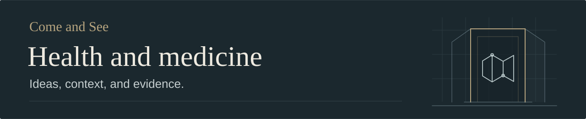

# Cancer research on tumor acidity, placebo, and prevention

**Status** Draft · **Research checked** November 11, 2026

## In brief

- **Documented finding.** Cancer covers many diseases, and some already have high cure rates. The National Cancer Institute reports a cure rate above 99% for stage I testicular nonseminoma. A claim about a cure needs to name the cancer, stage, treatment, and length of follow-up. [NCI on cancer biology](https://www.cancer.gov/about-cancer/understanding/what-is-cancer) · [NCI on testicular cancer](https://www.cancer.gov/types/testicular/hp/testicular-treatment-pdq)
- **Documented finding and open hypothesis.** The fluid around some solid tumors becomes acidic. In mice, bicarbonate reduced spread in some models while primary breast tumors continued growing at a similar rate. A 20-person liver-cancer trial found less viable tumor after clinicians added bicarbonate locally to an existing procedure. A survival advantage remains unestablished. Human studies using urine pH leave open whether an oral intervention changed the pH around the tumor. [Mouse study](https://pubmed.ncbi.nlm.nih.gov/19276390/) · [Liver-cancer pilot](https://elifesciences.org/articles/15691.pdf) · [2026 colorectal cancer study](https://www.frontiersin.org/journals/oncology/articles/10.3389/fonc.2026.1867616/full)
- **Disputed claims.** The folder's baking soda and molasses claim assumes sugar carries bicarbonate into tumors. The proposed mechanism and cure lack reliable clinical evidence, and excessive baking soda can cause serious harm. The separate claim that cancer is a fungal infection conflicts with evidence about how cancers develop. [Human tumor metabolism study](https://pubmed.ncbi.nlm.nih.gov/26853473/) · [Toxicity case report](https://pmc.ncbi.nlm.nih.gov/articles/PMC9475337/) · [NCI on cancer biology](https://www.cancer.gov/about-cancer/understanding/what-is-cancer)
- **Documented finding.** In small randomized trials, people reported less cancer-related fatigue after knowingly taking an inactive pill. Fatigue relief matters in its own right. The studies measured symptoms, and effects on cancer progression or survival remain unestablished. Across 45 advanced solid-tumor trials, the pooled rate of measured tumor response in placebo groups was about 1%. That figure describes what happened in those groups, with causes of individual responses unresolved. [Survivor trial](https://www.nature.com/articles/s41598-018-20993-y) · [Advanced-cancer trial](https://pubmed.ncbi.nlm.nih.gov/36106759/) · [Pooled tumor-response data](https://pubmed.ncbi.nlm.nih.gov/36444211/)
- **Documented findings.** Immunity, infections, and lifestyle affect specific cancer outcomes. HPV vaccination has reduced cervical cancer rates, a structured exercise program improved disease-free survival after surgery and chemotherapy for colon cancer, and the FDA approved an oncolytic virus therapy for certain recurrent melanoma lesions. These studies answer different questions about prevention, recovery after treatment, and local tumor treatment. [HPV registry study](https://pubmed.ncbi.nlm.nih.gov/34741816/) · [Colon-cancer exercise trial](https://pubmed.ncbi.nlm.nih.gov/40450658/) · [FDA melanoma indication](https://www.fda.gov/vaccines-blood-biologics/cellular-gene-therapy-products/imlygic)
- **Interpretation and disputed claim.** Long trials and fixed patent terms can make some prevention and early-stage research less attractive to private firms. That is a measurable funding problem. The claim that institutions are suppressing a proven cure would require direct evidence of a reproducible cure and specific acts of suppression. The folder's original notes give no such evidence. [Budish, Roin, and Williams, cancer trial investment study](https://pmc.ncbi.nlm.nih.gov/articles/PMC4557975/)

## What acidity changes around a tumor

**Documented findings.** Some solid tumors release acid faster than nearby blood flow can carry it away. The fluid immediately outside the cells can become acidic even while the cells maintain a different internal pH. In experiments, that environment can help tumor cells invade nearby tissue and make it harder for some immune cells to attack. The lungs and kidneys regulate blood pH within a narrow range. Urine pH can change as the kidneys excrete acid or bicarbonate. A urine test cannot tell whether the fluid around a tumor changed. [Gillies and colleagues on tumor acidity](https://www.frontiersin.org/journals/oncology/articles/10.3389/fonc.2022.981718/full) · [Pilon-Thomas and colleagues on immune response in mice](https://pmc.ncbi.nlm.nih.gov/articles/PMC4829106/) · [Acid–base physiology](https://www.merckmanuals.com/professional/nephrology/acid-base-regulation-and-disorders/acid-base-regulation)

### What researchers measured

- **Tumor acidity and spread in mice.** Robey and colleagues found that bicarbonate raised the pH outside breast tumor cells and reduced spread to some sites. Primary breast tumors grew at a similar rate in both groups. Separate experiments found reduced spread in a prostate cancer model and no statistically significant difference in a melanoma model. [Robey and colleagues, 2009](https://pubmed.ncbi.nlm.nih.gov/19276390/)
- **Tolerability of oral bicarbonate in people.** Eight patients with pancreatic cancer enrolled in Gem-TABS, a phase I study of oral bicarbonate with chemotherapy. The investigators reported stomach and intestinal side effects and problems with taste across their oral bicarbonate studies. The small, uncontrolled trial leaves any survival benefit unresolved. [Gem-TABS trial record](https://clinicaltrials.gov/study/NCT01198821) · [Investigators' results](https://www.frontiersin.org/journals/oncology/articles/10.3389/fonc.2022.981718/full)
- **Survival in pancreatic cancer.** A retrospective study found median survival of 15.4 months in 36 patients offered an alkalizing diet and bicarbonate, compared with 10.8 months in 89 patients treated at another center. Thirty-two of the 36 also received intravenous vitamin C. The study measured urine pH and could not isolate the contribution of bicarbonate. The group included all 28 patients from an earlier report by the same clinic, so the two publications share data. [Hamaguchi and colleagues, 2020](https://pmc.ncbi.nlm.nih.gov/articles/PMC7652496/)
- **Urine pH and survival in colorectal cancer.** A review of 129 patient records linked higher urine pH to longer survival in some subgroups, including people whose tumors had RAS mutations. Everyone received standard cancer treatment and some form of alkalization therapy. Bicarbonate was optional, and the study had no comparison group that skipped alkalization. Differences in health or other treatments could explain part of the association. [Suzuki and colleagues, 2026](https://www.frontiersin.org/journals/oncology/articles/10.3389/fonc.2026.1867616/full)
- **Local response in liver cancer.** A randomized pilot assigned 20 people with hepatocellular carcinoma to chemoembolization, which delivers chemotherapy and blocks blood flow to the tumor, with or without local bicarbonate. On imaging after the first procedure, the geometric mean of viable tumor remaining was 4.6% with bicarbonate and 25.4% without it. Four control patients later switched treatments, and the randomized comparison left survival benefit unresolved. A 2025 follow-up described 413 treated patients using historical comparisons. A larger randomized trial could test whether the local effect translates into longer survival. [Chao and colleagues, 2016, Table 4](https://elifesciences.org/articles/15691.pdf) · [Jin and colleagues, 2025](https://pmc.ncbi.nlm.nih.gov/articles/PMC12399753/)

**Personal account and disputed claims.** The original note cites Vernon Johnston's account of recovering from prostate cancer after taking baking soda and molasses. The evidence reviewed here did not include an independently verified clinical record of his diagnosis, treatments, and follow-up. The proposed mechanism assumes that a tumor taking up sugar would also take up the bicarbonate mixed with it. Glucose uptake does not establish that a second substance mixed with sugar will reach the same cells. The note also repeats the claim that cancer is a fungal infection. That explanation conflicts with evidence tracing cancers to changes in a person's own cells. Some infections do increase the risk of particular cancers. [Human tumor metabolism study](https://pubmed.ncbi.nlm.nih.gov/26853473/) · [NCI on cancer biology](https://www.cancer.gov/about-cancer/understanding/what-is-cancer) · [NCI on infectious causes](https://www.cancer.gov/about-cancer/causes-prevention/risk/infectious-agents)

**Safety.** Excess baking soda can make the blood dangerously alkaline and disrupt electrolytes. The studies above do not support using it to replace or delay cancer treatment. Anyone considering bicarbonate or an alkaline diet during treatment should discuss it with their oncology team. [Toxicity case report](https://pmc.ncbi.nlm.nih.gov/articles/PMC9475337/) · [NCI on diets and supplements during cancer care](https://www.cancer.gov/about-cancer/treatment/cam/diets-supplements)

## What placebo studies can tell us about fatigue

**Documented findings.** In an *open-label placebo* trial, participants know the pill contains no active drug. A 21-day trial randomized 74 cancer survivors and found greater improvement in reported fatigue and fatigue-related quality of life with open-label placebo than with usual care. A separate trial randomized 90 people with advanced cancer, of whom 84 were evaluable. After one week, scores improved by 6.6 points in the placebo group and 2.1 in the waitlist group on the same fatigue scale. The waitlist group then crossed over to placebo, ending the controlled comparison. [Hoenemeyer and colleagues, 2018](https://www.nature.com/articles/s41598-018-20993-y) · [Yennurajalingam and colleagues, 2022](https://pubmed.ncbi.nlm.nih.gov/36106759/)

**Interpretation and open question.** Expectations, the routine of taking a pill, and the attention involved in care could all affect the experience or reporting of fatigue. The trials could not isolate those contributions. How long the benefit lasts and how it compares with a program that gives both groups equal attention remain open questions. Established fatigue care has its own evidence. The ASCO and Society for Integrative Oncology guideline supports approaches such as exercise, cognitive behavioral therapy, and mindfulness programs in defined settings. [Advanced-cancer trial discussion](https://academic.oup.com/oncolo/article/27/12/1081/6700570) · [ASCO–SIO fatigue guideline](https://ascopubs.org/doi/10.1200/JCO.24.00541)

**Documented findings.** In 45 phase III trials of drugs for advanced solid tumors, the pooled rate of measurable tumor response in placebo arms was 1% (95% confidence interval, 0–2%). This was an estimate across trials, most of which enrolled people who had received previous cancer treatment. A response in a placebo arm could reflect effects of previous or concurrent care or rare spontaneous regression. A study comparing a new drug plus standard care with placebo plus standard care can estimate what the new drug adds. [Sachdev and colleagues' pooled analysis](https://pmc.ncbi.nlm.nih.gov/articles/PMC9700265/) · [FDA guidance on placebo-controlled cancer trials](https://www.fda.gov/media/130326/download)

## Where prevention, lifestyle, and immune treatment have changed outcomes

- **Preventing an infection can prevent cancer.** The immune system usually clears HPV, but persistent high-risk infection can lead to cervical cancer. In England, a national registry study estimated an 87% relative reduction in cervical cancer rates among young women offered HPV vaccination at ages 12–13 compared with the unvaccinated reference cohort. [NCI on HPV and cervical cancer](https://www.cancer.gov/types/cervical/causes-risk-prevention) · [Falcaro and colleagues, 2021](https://pubmed.ncbi.nlm.nih.gov/34741816/)
- **Lifestyle interventions can have measurable effects after cancer treatment.** The 2025 CHALLENGE trial randomized 889 people after surgery and adjuvant chemotherapy for colon cancer. At five years, disease-free survival was 80.3% with a three-year structured exercise program versus 73.9% with health education. The outcome counted cancer recurrence, a new primary cancer, or death. This result applies to a specific program and population. [Courneya and colleagues, 2025](https://pubmed.ncbi.nlm.nih.gov/40450658/)
- **A virus can be part of a defined cancer treatment.** The FDA approved talimogene laherparepvec (T-VEC) for local treatment of certain melanoma lesions that recur after surgery and cannot be removed. In its phase III trial, 16.3% of participants receiving T-VEC had a tumor response that lasted at least six months, compared with 2.1% in the comparison group. The FDA label says effects on overall survival and on metastases in internal organs have not been shown. [Phase III melanoma trial](https://pubmed.ncbi.nlm.nih.gov/26014293/) · [FDA prescribing information](https://www.fda.gov/media/94129/download)

## What financial incentives can explain

**Documented finding.** The NCI projected $208.9 billion in U.S. cancer care expenditures for 2020. That figure measures spending on care in one country in one year. It does not substantiate the inherited note's trillion-dollar figure, which gave no year, geography, or definition of what was counted. [NCI estimates and methods](https://progressreport.cancer.gov/after/economic_burden)

**Interpretation drawn from evidence.** Economists Eric Budish, Benjamin Roin, and Heidi Williams found that private cancer research tilted away from projects with long times to market. A prevention trial may need years to observe enough new cases to measure its effect. A fixed patent term can leave fewer years to sell a product under patent once those trials end. This gives a specific explanation for why some prevention or early-stage research might attract less investment. Public HPV vaccination programs and published trials of structured exercise also show where prevention and supportive care have been tested in practice. [Cancer trial investment study](https://pmc.ncbi.nlm.nih.gov/articles/PMC4557975/) · [HPV program study](https://pubmed.ncbi.nlm.nih.gov/34741816/) · [CHALLENGE trial](https://pubmed.ncbi.nlm.nih.gov/40450658/)

**Question with insufficient evidence.** Was a specific effective treatment deliberately suppressed? Answering that would take two kinds of evidence. Independent trials would need to establish a durable benefit for a defined cancer, and records would need to identify who blocked what and when. A plausible financial incentive can guide that inquiry. It cannot establish that the treatment works or that someone blocked it.

## How to read the next cancer claim

Ask **what was measured, in whom, and compared with what**. Feeling less fatigued, seeing a treated lesion shrink, living longer, and avoiding cancer in the first place each matter. Each requires its own evidence. For a tumor-acidity treatment, look for evidence that the intervention reached the tumor, a controlled comparison that isolates its contribution, and follow-up long enough to measure the benefit and harms that matter to patients.

## Sources and revision record

- **Scope.** This is a focused review of the folder's original claims. It draws on original experiments, clinical trials and registrations, observational cohorts, a pooled analysis of placebo arms, and guidance from the FDA, NCI, ASCO, and SIO. Study designs and limitations are recorded beside the findings.
- **November 11, 2026.** Developed the folder introduction, bicarbonate note, and placebo placeholder into this article. The original introduction and bicarbonate text are recoverable in Git history (`65b42aa` and `25b4aff`). The old pages now point to the relevant sections. Johnston's clinical history remains unverified.
