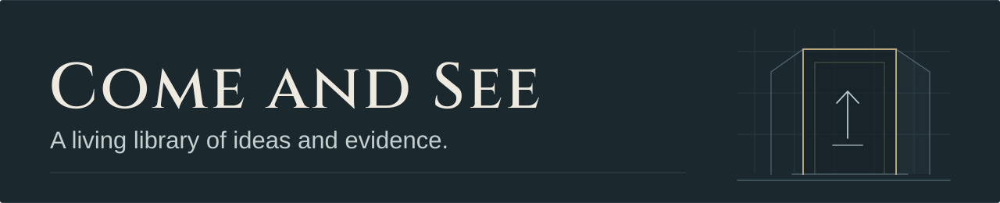

# Come and See headers

A shared SVG header family for the reference library. Each panel uses an open architectural threshold: an invitation to examine an idea. A small mark inside the opening identifies the subject without implying that its claims have been verified.

## Visual system

| Role | Value |
| :--- | :--- |
| Ink background | `#1b282e` |
| Aperture interior | `#172228` |
| Paper text | `#eeeae0` |
| Supporting text | `#c6cfd0` |
| Muted brass | `#b6a47f` |
| Slate geometry | `#81979f` |

The main wordmark uses Cinzel in paper white. It is drawn as outlines to render consistently in every viewer. The topic titles use Georgia with a Times New Roman fallback, and supporting text uses Arial with Helvetica and sans-serif fallbacks. [Cinzel and its SIL Open Font License](https://github.com/google/fonts/tree/main/ofl/cinzel)

Every panel is 1280 × 260 with a matching viewBox. The main title carries the hierarchy; fine architectural guides and subject marks remain secondary. The palette stays fixed across topics.

## Header map

| File | Visible subject | Mark |
| :--- | :--- | :--- |
| [come-and-see.svg](come-and-see.svg) | Come and See | Upward path through a threshold |
| [power-and-governance.svg](power-and-governance.svg) | Power and governance | Three columns |
| [universe-and-mind.svg](universe-and-mind.svg) | Universe and mind | Intersecting waves |
| [ancient-world.svg](ancient-world.svg) | Ancient world | Stepped stone form |
| [historical-investigations.svg](historical-investigations.svg) | Historical investigations | Document and marginal note |
| [space-and-technology.svg](space-and-technology.svg) | Space and technology | Trajectory and satellite |
| [world-crises.svg](world-crises.svg) | World crises | Routes and reference lines |
| [health-and-medicine.svg](health-and-medicine.svg) | Health and medicine | Molecular strands |
| [mind-and-learning.svg](mind-and-learning.svg) | Mind and learning | Branching path |
| [war-and-accountability.svg](war-and-accountability.svg) | War and accountability | Balanced scales |

## Usage

From the repository's main README:

```markdown

```

From a topic folder one level below the root:

```markdown

```

Adjust the relative path for deeper documents. Keep the topic title as a normal Markdown heading too, and supply meaningful image alt text so navigation does not depend on the banner. The small supporting text and decorative details are secondary at narrow widths.

## Creation decisions

This family extends Project Gateway's restrained archival palette and serif/sans-serif pairing, using a distinct aperture rather than its concentric rings. Geometry is specific to each topic; numbering, status badges, bright accent colors, and decorative stock artwork are omitted.

All artwork is drawn directly in self-contained SVG. Each file has an accessible title, description, image role, and fixed viewBox, with no scripts, animation, external resources, or foreignObject content. Topic labels are editorial navigation choices, separate from inherited folder names and evidence classifications.
